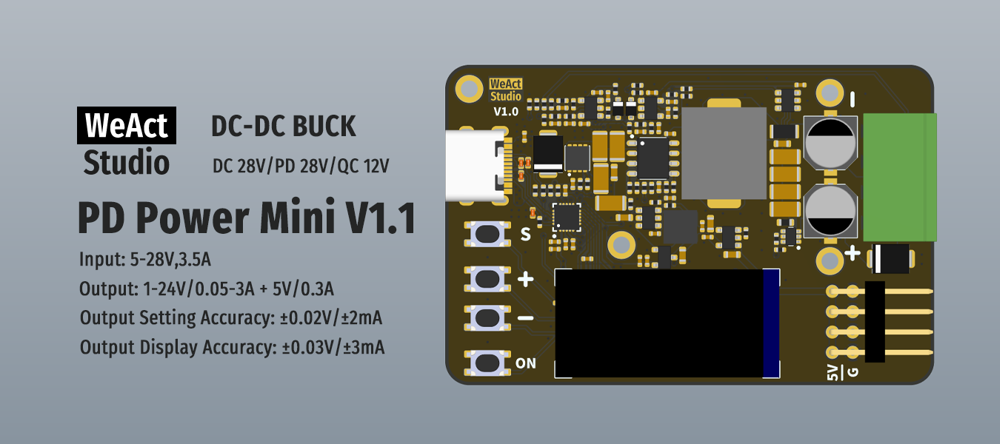
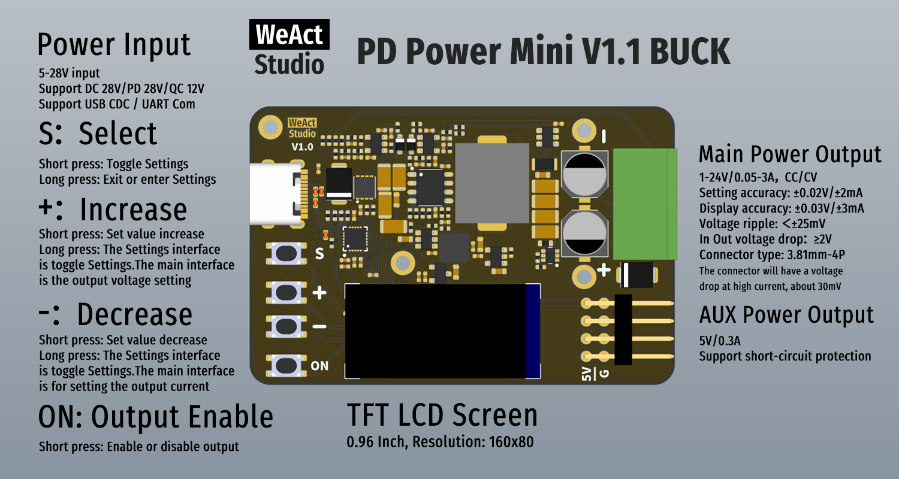

* [中文版本](./README_zh.md)
# WeActStudio.PDPowerMiniV1.1-Buck


|Specification||
|:-:|:-:|
|Input|DC 28V/PD 28V/QC 12V,3A|
|Output|1-24V/0.05-3A + 5V/0.3A|
|Output Setting Accuracy|±0.02V/±2mA|
|Output Display Accuracy|±0.03V/±3mA|
|Main Output Voltage Ripple|<±25mV|
|Output Protection|Overcurrent Protection,Short-circuit Protection|
> Note: The main output current of 2A can operate for a long time, while 3A current requires enhanced heat dissipation

## Product Introduction

### Setting Introduction
1. `PD Vset` – PD Protocol Request Voltage: Adjustable from 8–28 V, 0.1 V step. Setting takes effect only when output is disabled.
2. `Brightness` – Brightness: Adjustable from 0–100%; 0–10% corresponds to ultra-low brightness.
3. `Reverse Dis` – Reverse Display: 0 = Normal, 1 = 180° rotation. Setting takes effect after power cycle.
4. `OCP Enable` – Over-Current Protection: 0 = Disabled, 1 = Enabled. Output shuts down after approximately 200 ms when current exceeds the set value.
5. `OC Discharge` – Over-Current Discharge: 0 = Disabled, 1 = Enabled.
6. `AUTO OUT` – Auto Output: 0 = Disabled, 1 = Enabled. Output automatically enables after power-on.
7. `ON Time` – Output On Duration: 0:00–999:59 (mm:ss), default 0. Duration for which the output remains enabled. <small>(V1.0.2.0 and above)</small>
8. `OFF Time` – Output Off Duration: 0:00–999:59 (mm:ss), default 0. Duration for which the output remains disabled. <small>(V1.0.2.0 and above)</small>
9. `Timer En` – Timer Mode: 0 = Disabled, 1 = Enabled. When enabled, press ON to start the sequence and press ON again to stop it. The ON/OFF block turns yellow while the sequence is running. <small>(V1.0.2.0 and above)</small>
10. `Filter.Win` – Output Filter Window: Adjustable from 1–200, default value 50.
11. `Output Comp` – Output Compensation: 0 = Disabled, 1 = Enabled.
12. `UART Mode` – UART Mode: 0 = Disabled, 1 = Enabled. Setting takes effect after power cycle.
13. `UART Baudrate` – UART Baudrate: 0-6, respectively corresponding to 9600, 19200, 38400, 57600, 115200, 230400, 460800.
14. `Factory Reset` – Factory Reset: Set to 1 and exit the settings menu to restore factory defaults (calibration values will not be cleared).
15. `Offset Enable` – Calibration Enable: 0 = Disabled, 1 = Enabled. Factory default is 1 (calibrated).
> A duration of 0 means the corresponding phase is not executed: an OFF Time of 0 ends the sequence after the On phase (one-shot), and an ON Time of 0 prevents the sequence from starting, in which case `ERR` is displayed. The remaining time is not shown on screen.

> UART pins are assigned to DP and DM of Type‑C connector:
DP → TX, DM → RX, 3.3 V logic level.  
`Note`: The external UART chip must feature reverse-current protection (e.g., CH340K) to prevent power backfeeding and PDPowerMiniV1.1 startup failure when the UART side is powered up first.

### Computer Software Introduction
Web tool: https://tools.weactstudio.com/PDPowerMini/
Local version (Windows): [Tools/](Tools/)

```
/*---------------------------------------
- WeAct Studio Official Link
- taobao: WeActStudio.taobao.com
- aliexpress 1: WeActStudio.aliexpress.com
- aliexpress 2: WeActStudioOne.aliexpress.com
- github: github.com/WeActStudio
- gitee: gitee.com/WeActStudio
- blog: blog.weactstudio.com
---------------------------------------*/
```
